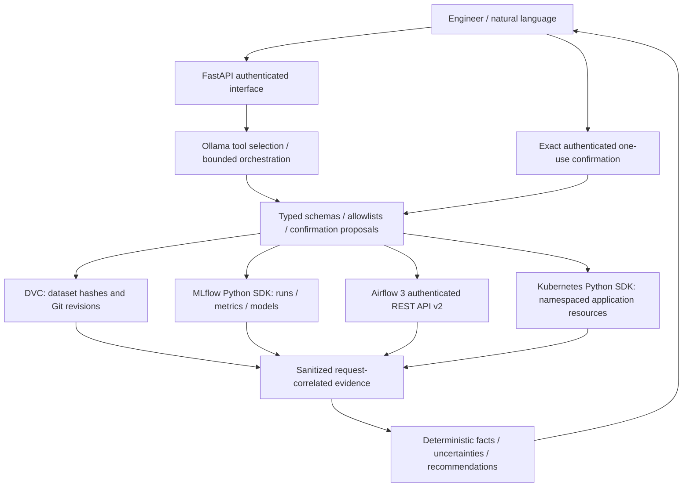
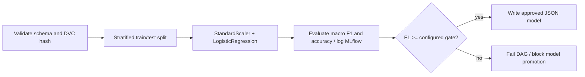

# System architecture

The LLM selects tools through Ollama's supported `tools` API in one bounded planning call.
Typed Python workflows resolve dependent references; large service payloads are not returned
to an iterative LLM loop. Pydantic validates arguments
again at execution, rejects extra fields and bounds inputs. There is no shell execution tool.
DVC subprocess arguments are fixed, shell-free, timeout-bounded and revision/path-validated.
The registry centralizes authorization, redaction and JSON audit logs. External logs and
metrics never supply permissions or instructions. Human confirmation is a separate endpoint.

The mandatory `assess_model` workflow queries recent MLflow runs first, reads the selected
run's recorded DVC reference, verifies that reference against committed metadata, inspects
Kubernetes health and deployed run identity, and queries recent Airflow runs. Failures remain
explicit unknowns; they do not become fabricated results. The assessment never trains or restarts.

Both DVC and Airflow call the same training stages. Airflow run directories prevent artifact
collisions and the DAG limits concurrent runs to one. Dataset MD5 identifies the actual bytes;
Git SHA identifies the metadata revision. Model JSON carries the run ID and lineage into the
inference image. The Kubernetes environment is stamped with that run ID for cross-system
comparison; `/version` provides the model's own identity.

The prediction service scales independently of the agent. Its readiness probe checks model
availability; liveness checks process responsiveness. Kubernetes events and container restart
counts supplement phase/readiness information. Service endpoint inspection distinguishes a
configured Service from one with ready backends.

